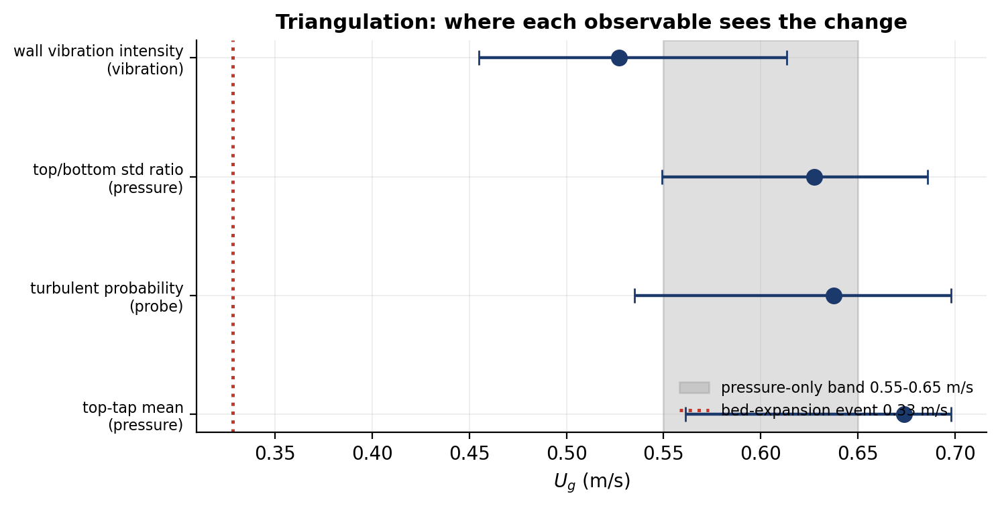
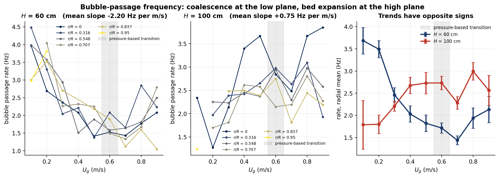

# Machine Learning for Gas–Solid Fluidized-Bed Diagnostics

Machine-learning models for a 3-D gas–solid fluidized-bed measurement campaign —
**differential pressure** (6 taps, 500 Hz), **tri-axial wall vibration** (6 sensors,
1666 Hz) and **optical-fibre-probe local solids fraction** (50 kHz, 2 channels):

- a **classifier** that identifies the bubbling-to-turbulent flow regime from
  10.5 s of optical-probe signal, and a **regressor** that predicts the
  continuous gas velocity from the same features;
- the **physical analyses** built alongside them — the flow-regime transition,
  bubble coalescence, and the limits of what this campaign can identify.

Research carried out at the Beacons of Excellence Research and Innovation
Institute, University of Nottingham Ningbo China (supervisor: Prof. Xiaoyang Wei).

---

## 1. Machine-learning models

36 time-domain, spectral and wavelet features from 10.5 s of probe signal per
record; 434 records spanning 86 operating conditions. Results are means over
**ten independent splits**.

| Task | Protocol | Result | Baseline |
|---|---|---|---|
| bubbling vs turbulent **classification** | leave-one-replicate-out | **0.829 ± 0.015**, macro-F1 0.82 | 0.592 |
| bubbling vs turbulent **classification** | **unseen radial position** | **0.790 ± 0.015**, macro-F1 0.78 | 0.592 |
| continuous gas velocity **regression** | leave-one-replicate-out | **R² = 0.63**, MAE **0.119 m/s** | R² = 0 |
| continuous gas velocity **regression** | unseen radial position | R² = 0.57, MAE 0.127 m/s | R² = 0 |

Negative results are reported as negative results: the *transition* regime is not
separable as a discrete third class (macro-F1 0.51), and nine-class velocity
classification does not work (0.285 vs 0.129, though 59–65 % of predictions land
within ±0.1 m/s). Both are consistent with the transition being a continuum and
with the local probe carrying regime rather than velocity information.

Evidence: `scripts/07`, `scripts/12`,
`results/tables/robustness_classification_summary.csv`,
`results/tables/robustness_regression_summary.csv`,
`results/figures/probe_confusion_matrices.png`.

---

## 2. Flow-regime transition

Three instrument-only estimators on the differential-pressure recordings put the
bubbling → turbulent transition at **0.55 – 0.65 m/s** (top-tap break 0.65,
axial-contrast break 0.65, low-tap plateau decline 0.55). The classic "peak of
the pressure-fluctuation intensity" criterion is **not applicable** here: the
summed standard deviation is still rising at 0.9 m/s.

The transition is then triangulated with one breakpoint estimator applied to
four physically unrelated observables:

| Observable | Instrument | Breakpoint (95 % bootstrap CI) |
|---|---|---|
| top-tap mean pressure (110–130 cm) | differential pressure | **0.67 m/s** (0.56–0.70) |
| top/bottom fluctuation ratio | differential pressure | **0.63 m/s** (0.55–0.69) |
| wall-vibration intensity | tri-axial accelerometers | **0.53 m/s** (0.45–0.61) |
| out-of-fold turbulent probability | optical fibre probe | **0.64 m/s** (0.54–0.70) |

All four intervals overlap (common intersection 0.56–0.61 m/s); the full spread
is **0.53 – 0.67 m/s**, and 4/4 estimates lie within ±0.05 m/s of the
pressure-only band.

Evidence: `scripts/02`, `scripts/13`, `results/tables/pressure_regime_transition.json`,
`results/figures/triangulation_forest.png`,
`results/figures/pressure_std_vs_velocity.png`.

<p align="center">
  
  
</p>

---

## 3. Bubble coalescence

A dual-tip probe sees each bubble as a dip in the local solids fraction, so the
records carry a direct measurement of bubble passage (`scripts/11`):

| Measurement height | Slope of passage rate vs gas velocity (pooled, per-position intercepts) | Significance |
|---|---|---|
| **60 cm** (dense bubbling zone) | **−2.02 Hz per (m/s)** | p = 2 × 10⁻⁶, n = 45, negative at **5/5** radial positions |
| **100 cm** (upper region) | **+0.87 Hz per (m/s)** | p = 0.005, n = 41 |

Two strong trends of **opposite sign**: bubble coalescence at the low plane, bed
expansion at the high plane. The two curves cross at **0.33 m/s** (95 % CI
0.26–0.48), measurably earlier than the regime transition. Passage rates span
0.19–5.63 Hz and dip durations 20–1950 ms — both inside the range expected for a
bubbling bed.

**Negative result:** pooling the two heights cancels the opposing trends; the
pooled two-segment fit has R² = −6.2, worse than the mean.

Evidence: `scripts/11`, `results/figures/bubble_rate_vs_velocity.png`,
`results/figures/bubble_slope_map.png`.

---

## 4. What this campaign cannot identify

| Finding | Value | Artefact |
|---|---|---|
| Total bed pressure drop across 0.1–0.9 m/s | **+2.2 %** (95 % CI +0.6 to +3.9 %) — a packed bed would change by **+800 %** | `results/tables/umf_plateau_statistics.json` |
| `U_mf` identifiability | the profile-likelihood interval spans the entire 0.01–0.60 m/s grid — `U_mf` is **not identifiable** from this campaign, because no fixed-bed branch was sampled | `results/figures/umf_identifiability.png` |
| The ±0.05 m/s `U_mf` accuracy quoted in the project's earlier poster | **withdrawn** rather than reported as an unstable estimate | `scripts/10` |
| Absolute `εs` calibration | the available constants give a flat 0.29–0.51 field, so the pipeline reports probe voltage as the primary measurement and **rejects the calibration automatically** | `results/tables/ofp_calibration_diagnostic.json` |
| Pressure unit cross-check | if the readings are kPa, the implied bed-averaged bulk density is **662 kg/m³**, inside the 550–850 kg/m³ expected for an FCC bed | `results/tables/umf_unit_crosscheck.json` |

Individual taps change by up to a **factor of 47** over the same range, in
opposite directions: the solids redistribute inside the bed rather than the bed
being partly packed.

Evidence: `scripts/10`, `src/fbfml/analysis_concentration.py`.

---

## 5. Supporting analyses

| Analysis | Result | Artefact |
|---|---|---|
| Core–annulus structure: probe signal lower on the axis than near the wall | **14/17** conditions positive, sign test **p = 0.006** | `results/figures/ofp_radial_gradient.png` |
| Error budget of the probe campaign | repeat spread 85 mV vs spatial range 949 mV → **noise/signal = 0.09** | `results/tables/ofp_noise_budget.json` |
| Vibration features that track the velocity sweep (Spearman ρ) | `Level9_ratio` 0.87, dominant frequency 0.83, `Level6_ratio` 0.82, `std` 0.78 | `results/tables/vibration_monotonicity.csv` |
| Physical cross-check of the vibration channel | median per-sensor ρ between vibration intensity and gas velocity = **0.80** | `results/tables/vibration_per_sensor_check.csv` |
| Wide-ANN surrogate + activation study *(recorded results; the dataset belongs to the laboratory and is not redistributed)* | mean 5-fold CV **R² = 0.9455**; LeakyReLU 0.945 > ELU 0.934 > GELU 0.930 > ReLU 0.814 > Tanh 0.671 | `results/tables/surrogate_recorded_reference.csv` |

---

## 6. Repository layout

```
fluidized-bed-ml/
├── src/fbfml/                   reusable package — one responsibility per module
│   ├── paths.py                 single source of truth for data locations
│   ├── data_pressure.py         pressure logs (.xlsx, 500 Hz, 6 taps)
│   ├── data_vibration.py        accelerometer logs (.mat/.bin) + velocity inference
│   ├── data_ofp.py              optical-fibre-probe records (.pvd) + calibration
│   ├── features_wavelet.py      db4 12-level DWT features (validated)
│   ├── features_stats.py        time-domain descriptors
│   ├── analysis_inventory.py    asset register & completeness audit
│   ├── analysis_regime.py       transition velocity & axial profiles
│   ├── analysis_concentration.py solids-fraction field, gradient tests, error budget
│   ├── analysis_vibration.py    vibration features, ordering, monotonicity
│   ├── model_wide_ann.py        WideANN / MLP / ResidualMLP definitions
│   ├── train_cv.py              seeded k-fold harness (no scaler leakage)
│   └── viz.py                   plotting style + figure/table writers
├── scripts/                     numbered, runnable entry points (see below)
├── tests/                       regression tests, incl. the wavelet validation
├── legacy/                      archived original notebooks + MATLAB + mapping
├── docs/                        setup, data dictionary, quality report, contributions
└── results/{figures,tables}/    committed outputs of the scripts
```

### Scripts

| Script | What it produces |
|---|---|
| `01_data_inventory.py` | asset register, pressure/vibration health, probe coverage matrix |
| `02_pressure_regime.py` | transition-velocity estimators, axial profiles, PSDs, wavelet feature table |
| `03_wavelet_validation.py` | proof that the feature extractor matches the stored tables |
| `04_ofp_concentration.py` | 434 records → solids-fraction field, gradient test, error budget |
| `05_vibration_features.py` | wavelet + time-domain features, velocity recovery, monotonicity |
| `06_train_surrogate.py` | Wide-ANN 5-fold CV + activation ablation (needs the laboratory's surrogate dataset) |
| `07_regime_classification.py` | flow-regime / velocity classification from the probe signal, with baselines and confusion matrices |
| `08_verify_claims.py` | re-checks every headline number in this README against the generated tables |
| `09_package_data_release.py` | manifest + SHA-256 + datasheet for a public data release |
| `10_umf_analysis.py` | total bed pressure drop, `U_mf` identifiability, pressure-unit cross-check |
| `11_bubble_frequency.py` | bubble-passage statistics: coalescence vs bed expansion |
| `12_robustness.py` | seed-averaged classification and a continuous-velocity regression benchmark |
| `13_triangulation.py` | same breakpoint estimator applied to four independent observables |

---

## 7. Reproducibility and data handling

Everything reported above is produced by the scripts in this repository from the
raw recordings, and every headline number is re-checked against the generated
tables by `scripts/08_verify_claims.py` (**37/37 checks**).

* **Feature definition.** The db4 / 12-level / `symmetric` wavelet extractor in
  `src/fbfml/features_wavelet.py` reproduces the project's stored band-energy
  tables exactly (54/54 comparisons, worst relative error 6 × 10⁻¹²) and is
  protected by a regression test (`tests/test_wavelet_matches_vendor.py`).
* **Condition labelling.** The gas velocity of the vibration sessions is recovered
  from the acquisition timestamps; the rule is validated against the labelled
  folders and every table keeps a `velocity_inferred` flag, so a recovered value
  is never presented as a measured one.
* **Evaluation.** The k-fold harness in `src/fbfml/train_cv.py` fits its scaler
  inside each fold, seeds every random source from one integer, and reports
  classification and regression results as means over ten independent splits.
* **Calibration hygiene.** `analysis_concentration.calibration_plausibility()`
  checks the probe calibration against physical expectations and blocks absolute
  solids-fraction output when the constants do not belong to the campaign.
* **Data quality.** `docs/data_quality.md` documents every defect found in the
  recordings, with the magnitude of each and how the code handles it.

---

## 8. Quickstart

```bash
python -m venv .venv && source .venv/bin/activate
pip install -r requirements.txt

# point the code at the raw recordings (default: the parent directory of the repo)
export FBFML_DATA_ROOT="/path/to/raw/data"     # optional

python scripts/01_data_inventory.py
python scripts/02_pressure_regime.py
python scripts/03_wavelet_validation.py
python scripts/04_ofp_concentration.py         # ~2 min, caches to results/tables/
python scripts/05_vibration_features.py        # ~1 min
python scripts/07_regime_classification.py     # ~3 min, caches to results/tables/
python scripts/10_umf_analysis.py              # pressure-drop bookkeeping
python scripts/11_bubble_frequency.py          # ~3 min
python scripts/12_robustness.py                # ~10 min (10 seeds)
python scripts/13_triangulation.py
python scripts/08_verify_claims.py             # 37/37 claims re-checked
pytest -q                                      # add FBFML_SLOW_TESTS=1 for the full set
```

Expected layout of the raw data (see `docs/data_dictionary.md`):

```
<data root>/
├── Pressure_Energy/     0.1.xlsx … 0.9.xlsx, energy_0.1.xlsx … energy_0.9.xlsx
├── 20250609 LMF/        <condition>/1.mat … 7.mat (+ .bin)
└── 20250609 LC/         <height_cm>/<r_R>/<U_g>/*.pvd
```

`src/fbfml/paths.py` resolves everything from `FBFML_DATA_ROOT`; no absolute path
is hard-coded anywhere in the package. Run `python -c "from fbfml import paths;
print(paths.describe())"` to see what was resolved.

---

## 9. Data availability

The raw recordings are not stored in this repository (4.6 GB). Point the code at
them with `FBFML_DATA_ROOT`; `src/fbfml/paths.py` resolves every path from that one
variable and `python -c "from fbfml import paths; print(paths.describe())"` reports
what was found. `scripts/09_package_data_release.py` builds a manifest with SHA-256
checksums plus a datasheet for a public release.

| dataset | contents | size |
|---|---|---|
| `Pressure_Energy/` | 6 differential-pressure taps, 500 Hz, 9 gas velocities | 27 MB |
| `20250609 LMF/` | tri-axial accelerometers, 1666 Hz, 10 condition folders | 629 MB |
| `20250609 LC/` | dual-tip optical fibre probe, 50 kHz, 434 records | 3.2 GB |
| `training & validation/` | 40-sample labelled feature table (10 velocities × 4 temperatures) | 32 kB |

Two datasets used by the modelling notebooks belong to the laboratory and are not
redistributed: the upstream table behind the 40-sample set, and the 530-row
surrogate dataset. The surrogate work is therefore presented through its recorded
results (`results/tables/surrogate_recorded_reference.csv`) and a runnable
implementation (`scripts/06`).

## 10. Related publication

The modelling line developed here is continued in a study by the laboratory:

> Chen, X., Xu, Y., Yuan, Y., Lin, Q., Wei, X., Shao, Y., Zhu, J. & Li, D. (2026).
> *Data-driven machine learning for scale-up of bubbling and turbulent fluidized
> beds: flow hydrodynamics and reactor performance.* Engineering Applications of
> Computational Fluid Mechanics 20(1):2670348.
> [doi:10.1080/19942060.2026.2670348](https://doi.org/10.1080/19942060.2026.2670348)

It is cited here as the peer-reviewed continuation of the same problem (deep-width
ANN surrogate + SHAP on 76 / 152 mm beds), and as the source of context for the
surrogate configuration implemented in `scripts/06`.

## 11. Licence

Code: MIT. Derived tables and figures in `results/`: CC BY 4.0. The raw
experimental data is not covered by either and remains the property of the
laboratory.

---

## 12. 中文速览

这个仓库围绕"气固流化床诊断的机器学习"组织：从光纤探针信号做流型分类与气速回归，从压差与振动数据估计流型转变、直接量化气泡聚并，并界定这批实验数据能支持什么、不能支持什么。全部结论都能在 `results/` 里对应到表或图。

1. **核心模型**：10.5 s 探针信号 → 36 个特征（434 条记录 / 86 个工况）。鼓泡 vs 湍动分类 **0.829 ± 0.015**（10 个随机划分，多数类基线 0.59，macro-F1 0.82），在从未见过的径向位置上 **0.790 ± 0.015**；连续气速回归 **R² = 0.63，MAE = 0.12 m/s**（基线 R² = 0）。负结果照实报告：过渡流型不可作为第三类分开（macro-F1 0.51），9 类气速分类不成立（0.285 vs 0.129）。
2. **流型转变区间 0.55–0.65 m/s**，由三个仅用仪器的判据给出；四个物理上互不相关的观测量交叉验证（压差上测点 0.67、压差脉动比 0.63、壁面振动 0.53、探针分类概率 0.64 m/s），置信区间全部重叠。
3. **直接测到气泡聚并**：低位面（60 cm）气泡通过频率随气速下降（**−2.02 Hz/(m/s)**，p = 2×10⁻⁶，5/5 个径向位置），高位面（100 cm）上升（**+0.87**，p = 0.005）；两条曲线在 0.33 m/s 交叉。
4. **这批数据不能支持什么**：总床层压降在 0.1–0.9 m/s 内只变 **+2.2 %**（堆积床应为 +800 %），`U_mf` **不可辨识**——此前海报里的 ±0.05 m/s 精度被**撤回**而非照报；绝对固含率标定对本批次无效，流水线会自动拒绝输出。
5. **辅助分析**：核心–边壁结构 14/17 为正（p = 0.006）；探针噪声/信号 = 0.09；振动特征随气速单调（Spearman ρ 最高 0.87）；宽 ANN 代理模型的记录性结果见 `results/tables/surrogate_recorded_reference.csv`。

可复现性：仓库内的小波特征提取器与项目原有特征表逐点吻合（54/54，最大相对误差 6×10⁻¹²），并有回归测试保护；振动数据的气速由采集时间戳恢复并带 `velocity_inferred` 标记；`scripts/08` 对 README 里的每个数字逐条自检（37/37 通过）；缺陷与处理方式见 `docs/data_quality.md`。

启动：

```bash
export FBFML_DATA_ROOT="/path/to/raw/data"   # 原始 4.6 GB 数据不在仓库里
./run_all.sh                                # 全流程 + 自检 + 测试
```

文档地图：`docs/results.md`（全部结论）、`docs/data_dictionary.md`（字段说明）、
`docs/data_quality.md`（数据缺陷）、`docs/experimental_setup.md`（实验与判据）、
`docs/ROADMAP.md`（后续待办）。
