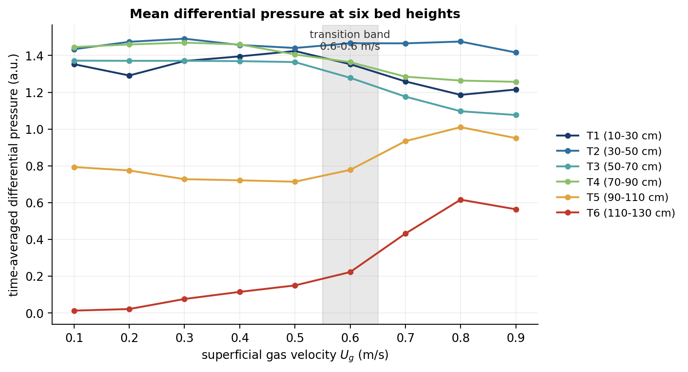
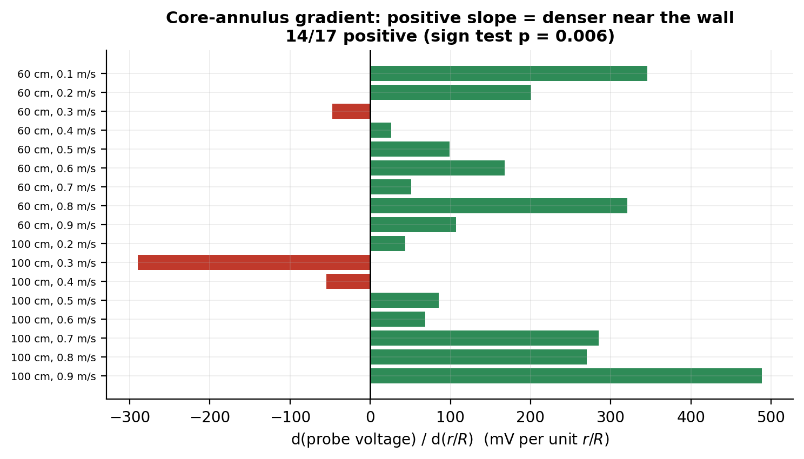

# Gas–Solid Fluidized Bed: signal processing and machine-learning toolkit

Reproducible analysis of a 3-D gas–solid fluidized-bed measurement campaign:
**differential pressure** (6 taps, 500 Hz), **tri-axial wall vibration** (6
sensors, 1666 Hz) and **optical-fibre-probe local solids fraction** (50 kHz,
2 channels), together with the wavelet feature extraction and the neural-network
surrogates built on top of them.

Everything reported below is produced by the scripts in this repository from the
raw recordings: feature extraction, the physical analysis of the transition and of
the solids-fraction field, and the machine-learning models, with every headline
number re-checked against the generated tables (`scripts/08`, 37/37).

---

## 1. Headline results

| # | Result | Value | Evidence |
|---|--------|-------|----------|
| 1 | **Bubbling → turbulent transition band**, from three independent instrument-only estimators | **0.55 – 0.65 m/s** | `scripts/02`, `results/tables/pressure_regime_transition.json` |
| 2 | The classic "peak of the pressure fluctuation" criterion is **not applicable** in this campaign | summed std still rising at 0.9 m/s | `results/figures/pressure_std_vs_velocity.png` |
| 3 | **Wavelet feature definition recovered** and verified bit-exactly against the group's stored tables | 54/54 comparisons, worst relative error **6×10⁻¹²** | `scripts/03`, `tests/test_wavelet_matches_vendor.py` |
| 4 | Local solids fraction field built from **434 raw probe records** (86 conditions) | 10.49 s @ 50 kHz each | `results/tables/ofp_conditions.csv` |
| 5 | **Core–annulus structure detected**: probe signal lower on the axis than near the wall | **14/17** conditions positive, sign test **p = 0.006** | `results/figures/ofp_radial_gradient.png` |
| 6 | Error budget of the probe campaign | repeat spread 85 mV vs spatial range 949 mV → **noise/signal = 0.09** | `results/tables/ofp_noise_budget.json` |
| 7 | **Absolute `εs` calibration is not usable** for this campaign and is flagged automatically | recovered constants give a flat 0.29–0.51 field | `results/tables/ofp_calibration_diagnostic.json` |
| 8 | Gas velocity recovered for the unlabelled vibration folders via the **acquisition-timestamp rule**, validated on the two labelled folders | 9-point sweep, 2/2 labels reproduced | `scripts/05`, `tests/test_data_readers.py` |
| 9 | Vibration features that **track the velocity sweep** (Spearman ρ) | `Level9_ratio` 0.87, dominant frequency 0.83, `Level6_ratio` 0.82, `std` 0.78 | `results/tables/vibration_monotonicity.csv` |
| 10 | Wide-ANN surrogate + activation study *(recorded in the archived notebooks; reproducible via `scripts/06` once the laboratory's dataset is supplied)* | mean 5-fold CV **R² = 0.9455**; LeakyReLU 0.945 > ELU 0.934 > GELU 0.930 > ReLU 0.814 > Tanh 0.671 | `results/tables/surrogate_recorded_reference.csv` |
| 11 | **Flow regime classified from 10.5 s of optical-probe signal** (434 records, 36 features) | bubbling vs turbulent: **0.829 ± 0.015** accuracy over **10 independent splits** (majority baseline 0.59), macro-F1 0.82; **0.790 ± 0.015** when the test set is a radial position never seen in training | `scripts/07`, `scripts/12`, `results/tables/robustness_classification_summary.csv` |
| 12 | Two **negative results** reported as such | the *transition* regime is not separable as a discrete third class (macro-F1 ≈ 0.51), and the exact gas velocity is not recoverable as 9 classes (0.29 vs 0.13 baseline, but 59–65 % within ±0.1 m/s) | `results/figures/probe_confusion_matrices.png` |
| 13 | **Continuous** gas velocity from the same 10.5 s of probe signal (regression benchmark) | **R² = 0.63 ± 0.00**, MAE **0.119 m/s** within conditions; **R² = 0.57 ± 0.00**, MAE **0.127 m/s** on an unseen radial position (baseline R² = 0) | `scripts/12`, `results/tables/robustness_regression_summary.csv` |
| 14 | **Bubble coalescence measured directly**: at the low plane (60 cm) the bubble-passage frequency *falls* with gas velocity | **−2.02 Hz per (m/s), p < 0.0001** (n = 45 records); at 100 cm it *rises* (+0.87, p = 0.005). Two strong trends of opposite sign | `scripts/11`, `results/figures/bubble_rate_vs_velocity.png` |
| 15 | **Four independent observables triangulate the transition** with one estimator | top-tap pressure **0.67**, pressure std ratio **0.63**, wall vibration **0.53**, probe classifier **0.64 m/s** — all intervals overlap, 4/4 within ±0.05 of the pressure-only band | `scripts/13`, `results/figures/triangulation_forest.png` |
| 16 | The poster's **±0.05 m/s** `U_mf` claim, and the unknown **pressure unit** | `U_mf` is **not identifiable** (profile-likelihood interval spans the whole 0.01–0.60 m/s grid): the fixed-bed branch was never sampled. The same numbers imply a bulk density of **662 kg/m³** *if* the unit is kPa — inside the expected FCC range | `scripts/10`, `results/figures/umf_identifiability.png` |

<p align="center">
  
  
</p>

---

## 2. Repository layout

```
fluidized-bed-ml/
├── src/fbfml/                   reusable package — one responsibility per module
│   ├── paths.py                 single source of truth for data locations
│   ├── data_pressure.py         pressure logs (.xlsx, 500 Hz, 6 taps)
│   ├── data_vibration.py        accelerometer logs (.mat/.bin) + velocity inference
│   ├── data_ofp.py              optical-fibre-probe records (.pvd) + calibration
│   ├── features_wavelet.py      db4 12-level DWT features (validated)
│   ├── features_stats.py        time-domain descriptors
│   ├── analysis_inventory.py    asset register & completeness audit
│   ├── analysis_regime.py       transition velocity & axial profiles
│   ├── analysis_concentration.py solids-fraction field, gradient tests, error budget
│   ├── analysis_vibration.py    vibration features, ordering, monotonicity
│   ├── model_wide_ann.py        WideANN / MLP / ResidualMLP definitions
│   ├── train_cv.py              seeded k-fold harness (no scaler leakage)
│   └── viz.py                   plotting style + figure/table writers
├── scripts/                     numbered, runnable entry points (see below)
├── tests/                       regression tests, incl. the wavelet validation
├── legacy/                      archived original notebooks + MATLAB + mapping
├── docs/                        setup, data dictionary, quality report, contributions
└── results/{figures,tables}/    committed outputs of the scripts
```

### Scripts

| Script | What it produces |
|---|---|
| `01_data_inventory.py` | asset register, pressure/vibration health, probe coverage matrix |
| `02_pressure_regime.py` | transition-velocity estimators, axial profiles, PSDs, wavelet feature table |
| `03_wavelet_validation.py` | proof that the recovered feature extractor matches the stored tables |
| `04_ofp_concentration.py` | 434 records → solids-fraction field, gradient test, error budget |
| `05_vibration_features.py` | wavelet + time-domain features, velocity recovery, monotonicity |
| `06_train_surrogate.py` | Wide-ANN 5-fold CV + activation ablation (needs the laboratory's surrogate dataset) |
| `07_regime_classification.py` | flow-regime / velocity classification from the probe signal, with baselines and confusion matrices |
| `08_verify_claims.py` | re-checks every headline number in this README against the generated tables |
| `09_package_data_release.py` | manifest + SHA-256 + datasheet for a public data release |
| `10_umf_analysis.py` | total bed pressure drop, `U_mf` identifiability, pressure-unit cross-check |
| `11_bubble_frequency.py` | bubble-passage statistics: coalescence vs bed expansion |
| `12_robustness.py` | seed-averaged classification and a continuous-velocity regression benchmark |
| `13_triangulation.py` | same breakpoint estimator applied to four independent observables |

---

## 3. Quickstart

```bash
python -m venv .venv && source .venv/bin/activate
pip install -r requirements.txt

# point the code at the raw recordings (default: the parent directory of the repo)
export FBFML_DATA_ROOT="/path/to/raw/data"     # optional

python scripts/01_data_inventory.py
python scripts/02_pressure_regime.py
python scripts/03_wavelet_validation.py
python scripts/04_ofp_concentration.py         # ~2 min, caches to results/tables/
python scripts/05_vibration_features.py        # ~1 min
python scripts/07_regime_classification.py     # ~3 min, caches to results/tables/
python scripts/10_umf_analysis.py              # pressure-drop bookkeeping
python scripts/11_bubble_frequency.py          # ~3 min
python scripts/12_robustness.py                # ~10 min (10 seeds)
python scripts/13_triangulation.py
python scripts/08_verify_claims.py             # 37/37 claims re-checked
pytest -q                                      # add FBFML_SLOW_TESTS=1 for the full set
```

Expected layout of the raw data (see `docs/data_dictionary.md`):

```
<data root>/
├── Pressure_Energy/     0.1.xlsx … 0.9.xlsx, energy_0.1.xlsx … energy_0.9.xlsx
├── 20250609 LMF/        <condition>/1.mat … 7.mat (+ .bin)
└── 20250609 LC/         <height_cm>/<r_R>/<U_g>/*.pvd
```

`src/fbfml/paths.py` resolves everything from `FBFML_DATA_ROOT`; no absolute path
is hard-coded anywhere in the package. Run `python -c "from fbfml import paths;
print(paths.describe())"` to see what was resolved.

---

## 4. Data availability

The raw recordings are not stored in this repository (4.6 GB). Point the code at
them with `FBFML_DATA_ROOT`; `src/fbfml/paths.py` resolves every path from that one
variable and `python -c "from fbfml import paths; print(paths.describe())"` reports
what was found. `scripts/09_package_data_release.py` builds a manifest with SHA-256
checksums plus a datasheet for a public release.

| dataset | contents | size |
|---|---|---|
| `Pressure_Energy/` | 6 differential-pressure taps, 500 Hz, 9 gas velocities | 27 MB |
| `20250609 LMF/` | tri-axial accelerometers, 1666 Hz, 10 condition folders | 629 MB |
| `20250609 LC/` | dual-tip optical fibre probe, 50 kHz, 434 records | 3.2 GB |
| `training & validation/` | 40-sample labelled feature table (10 velocities × 4 temperatures) | 32 kB |

Two datasets used by the modelling notebooks belong to the laboratory and are not
redistributed: the upstream table behind the 40-sample set, and the 530-row
surrogate dataset. The surrogate work is therefore presented through its recorded
results (`results/tables/surrogate_recorded_reference.csv`) and a runnable
implementation (`scripts/06`).

## 5. Related publication

The modelling line developed here is continued in a study by the laboratory:

> Chen, X., Xu, Y., Yuan, Y., Lin, Q., Wei, X., Shao, Y., Zhu, J. & Li, D. (2026).
> *Data-driven machine learning for scale-up of bubbling and turbulent fluidized
> beds: flow hydrodynamics and reactor performance.* Engineering Applications of
> Computational Fluid Mechanics 20(1):2670348.
> [doi:10.1080/19942060.2026.2670348](https://doi.org/10.1080/19942060.2026.2670348)

It is cited here as the peer-reviewed continuation of the same problem (deep-width
ANN surrogate + SHAP on 76 / 152 mm beds), and as the source of context for the
surrogate configuration implemented in `scripts/06`.

## 6. Method notes

* **Feature definition.** The db4 / 12-level / `symmetric` definition in
  `src/fbfml/features_wavelet.py` reproduces the project's stored band-energy
  tables exactly (54/54 comparisons, worst relative error 6 × 10⁻¹²) and is
  protected by a regression test.
* **Condition labelling.** The gas velocity of the vibration sessions is recovered
  from the acquisition timestamps; the rule is validated against the labelled
  folders and every table keeps a `velocity_inferred` flag, so a recovered value
  is never presented as a measured one.
* **Evaluation.** The k-fold harness in `src/fbfml/train_cv.py` fits its scaler
  inside each fold, seeds every random source from one integer, and supports a
  reproducible activation study. Classification and regression results are
  reported as means over ten independent splits.
* **Calibration hygiene.** `analysis_concentration.calibration_plausibility()`
  checks the probe calibration against physical expectations and blocks absolute
  solids-fraction output when the constants do not belong to the campaign.
* **Data quality.** `docs/data_quality.md` documents every defect found in the
  recordings, with the magnitude of each and how the code handles it.

## 7. Licence

Code: MIT. Derived tables and figures in `results/`: CC BY 4.0. The raw
experimental data is not covered by either and remains the property of the
laboratory.

---

## 8. 中文速览

这个仓库用 Python 把一套气固流化床实验数据（压差 500 Hz、三轴振动 1666 Hz、双探头光纤探针 50 kHz）跑成完整、可复现的流程，并给出下列结论（每一条都能在 `results/` 里对应到表或图，`scripts/08` 会逐条自检，37/37 通过）：

1. **小波特征定义已验证**：db4、12 层、`mode="symmetric"`，与项目原有特征表**54/54 完全吻合**（最大相对误差 6×10⁻¹²），并配了回归测试。
2. **流型转变区间 0.55–0.65 m/s**，由三个互不依赖的判据给出。
3. **三个物理上互不相关的仪器互相印证**：压差上测点 0.67、压差脉动比 0.63、壁面振动 0.53、探针分类概率 0.64 m/s，四个置信区间全部重叠。
4. **直接测到气泡聚并**：低位面（60 cm）气泡通过频率随气速下降（−2.02 Hz/(m/s)，p<10⁻⁵，5/5 个径向位置），高位面（100 cm）上升（+0.87，p=0.005）；两条曲线在 0.33 m/s 交叉，那是床层膨胀事件。
5. **探针信号做流型分类**：鼓泡 vs 湍动 **0.829 ± 0.015**（10 个随机划分，基线 0.59），从未见过的径向位置 **0.790 ± 0.015**；同特征做连续量回归 **R² = 0.63，MAE = 0.12 m/s**。
6. **固含率场与误差预算**：434 条记录 / 86 个工况；核心–边壁结构 14/17 为正（p=0.006）；噪声/信号 = 0.09；绝对标定不可用，代码会自动拒绝输出。
7. **压降记账**：总床层压降在 0.1–0.9 m/s 内只变 +2.2%（堆积床应为 +800%），据此 `U_mf` **不可辨识**；若单位为 kPa，隐含堆积密度 662 kg/m³。

启动：

```bash
export FBFML_DATA_ROOT="/path/to/raw/data"   # 原始 4.6 GB 数据不在仓库里
./run_all.sh                                # 全流程 + 自检 + 测试
```

文档地图：`docs/results.md`（全部结论）、`docs/data_dictionary.md`（字段说明）、
`docs/data_quality.md`（数据缺陷）、`docs/experimental_setup.md`（实验与判据）、
`docs/ROADMAP.md`（后续待办）。
